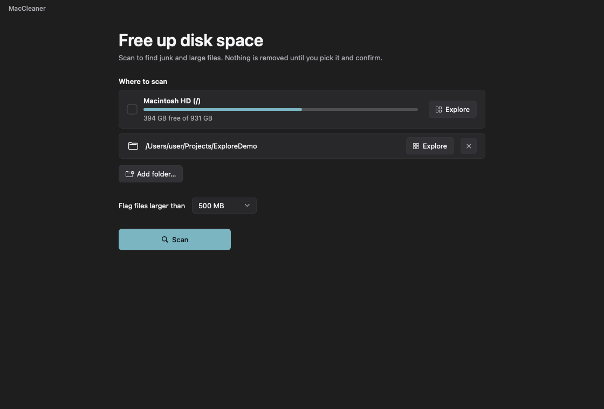
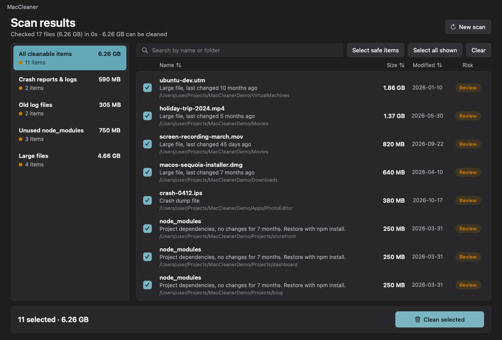
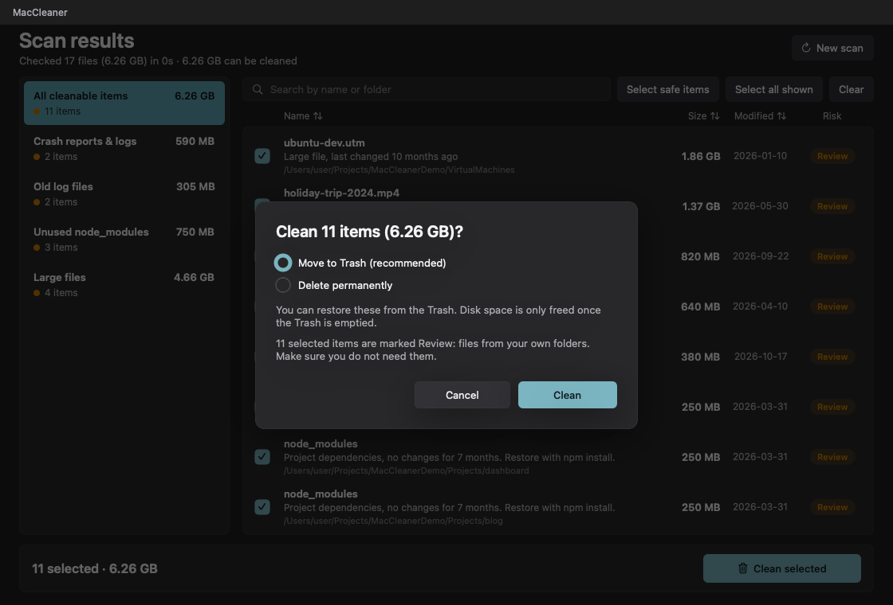
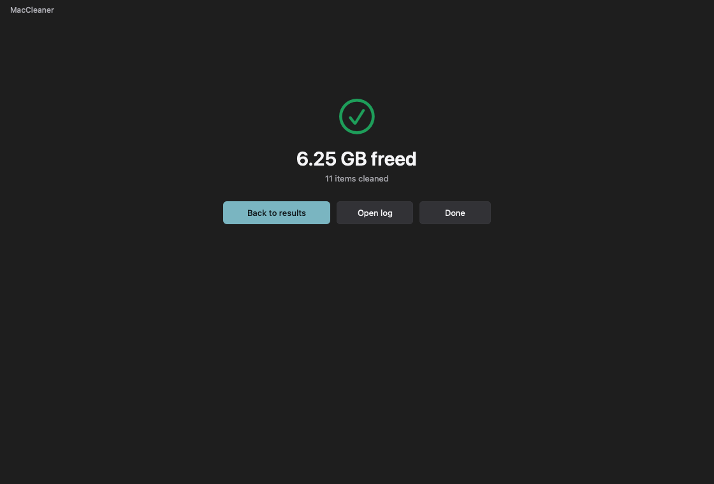
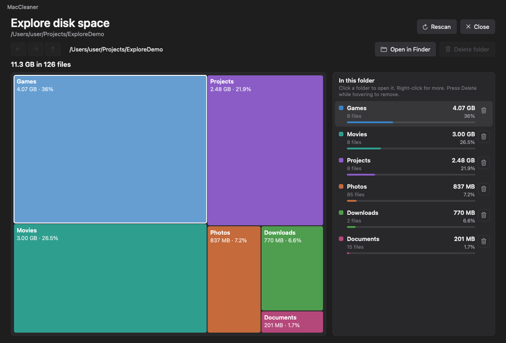
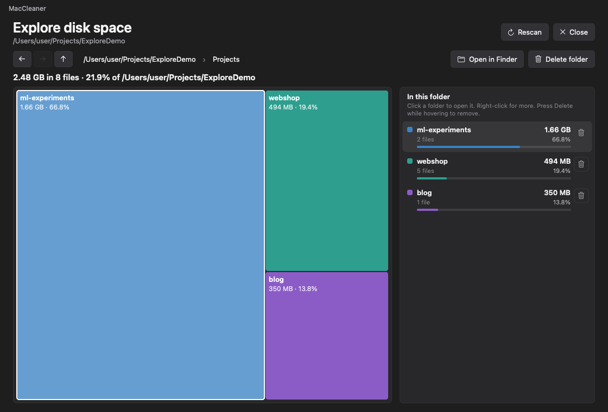
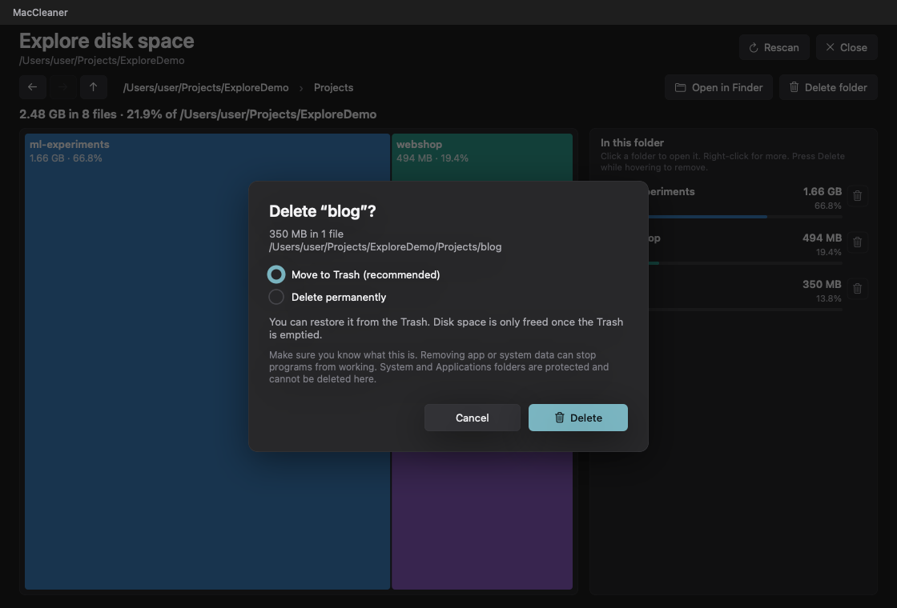

<p align="center">
  
</p>

# MacCleaner

A small, modern macOS storage cleaner. It scans your drives (or any folders you pick), finds junk and large
files, and lets you choose exactly what to remove. It can also **map where your space went**: an interactive
treemap of every folder that you can click through level by level. **Scanning is read-only. Nothing is deleted
until you pick it and confirm.**

## Screenshots

Pick what to scan, review the results, then confirm. (Shown with demo data.)

| | |
|---|---|
|  |  |
|  |  |

### Explore disk space

| | |
|---|---|
|  |  |
|  | |

## Explore disk space

Click **Explore** on any volume or folder on the home screen. MacCleaner maps the folder tree once (a few seconds
for a whole drive), then you can move around instantly:

- **Treemap:** every block is a folder or file, and its area is its size. Hover for details; the matching row in
  the list on the right lights up too.
- **Go deeper:** click a folder block (or its row) to open it. Folders are colour-coded, files are grey.
- **Go back easily:** Back / Forward / Up buttons, a clickable breadcrumb path, `Option+Left`, `Option+Right`,
  `Option+Up` or `Backspace`.
- **Delete from the map:** use the trash button on a row, right-click a block or row, press `Forward Delete` /
  `Command+Delete` while hovering, or use **Delete folder** to remove the folder you are in. You always get a
  confirm dialog (Move to Trash by default). Sizes and the treemap update straight away; no rescan needed.
- **Also:** open any item in Finder, and **Rescan** to pick up changes made elsewhere.

Deleting here goes through the same safety checks as the cleaner: `/System`, `/Applications`, `/Library`, `/usr`,
`/bin`, `/sbin`, system files, other users' profiles and the approved cache folders themselves can never be deleted
(their trash buttons are disabled and explain why), symlinks and firmlinks are never followed, and every action is
logged. Sizes are file sizes, not space allocated on disk, and cloud-only (evicted iCloud Drive) files are not counted.

## Run it

Requires macOS 14+ (Sonoma or newer, Apple Silicon / Intel). Build it (see [Build from source](#build-from-source)),
then open `dist/MacCleaner.app` or run `.build/release/MacCleanerApp`.

You can also pass folders to scan instead of the boot volume:
```bash
./dist/MacCleaner.app/Contents/MacOS/MacCleaner /Volumes/External "/Users/me/Movies"
```

## What it finds

| Category | Examples | Risk |
|---|---|---|
| Temporary files | user and `/private/tmp` temp folders, only if untouched for 24 h | Safe |
| Browser caches | Safari, Chrome, Brave, Edge, Arc, Firefox caches (never profiles, cookies or passwords) | Safe |
| App and developer caches | Xcode DerivedData & cache, Homebrew, npm, pip, Yarn, pnpm, CocoaPods, SwiftPM, NuGet | Safe |
| Crash reports and logs | `DiagnosticReports` (plus loose `.ips` / `.crash` / `.dmp` files, as Review) | Safe / Review |
| macOS & Xcode updates | `~/Library/Updates`, Xcode `iOS DeviceSupport` / `watchOS DeviceSupport` | Safe |
| Trash | `~/.Trash` emptied permanently | Safe |
| Old log files | `.log` / `.asl` over 1 MB, not modified for 30 days | Review |
| Old downloads | `.dmg`, `.pkg`, `.zip`, `.iso` installers and archives in `~/Downloads`, untouched for 90 days | Review |
| Unused `node_modules` | whole folder as one item, no changes for 90 days | Review |
| Large files | anything over your chosen size (default 500 MB) | Review |

Items marked **Locked** are shown so you can see what uses space, but cannot be selected: `/System`, `/Applications`,
`/Library`, `/usr`, `sleepimage` / `swapfile*`, system-immutable files (`SF_IMMUTABLE` / `SF_RESTRICTED`), other
users' profiles, and critical `~/Library` user stores (`Keychains`, `Preferences`, `Mail`, `Messages`, `Safari`, `Photos`).

**Review** items live in your own folders (for example a virtual machine image or video file in a project). They are
never pre-selected. "Select safe items" only ticks the Safe ones.

## How deletion stays safe

- The default is **Move to Trash**. Permanent delete is an explicit choice in the confirm dialog.
- Before each item is removed it is re-checked: still the same size and modified time as in the scan, not a
  protected path (case, `..`, `/var` -> `/private/var`, and APFS `/System/Volumes/Data` firmlinks are normalised),
  and no symlink anywhere in the path. A changed or suspicious item is skipped and reported.
- Symlinks are never followed, when scanning or deleting. Deleting a folder that contains one removes the link only,
  never what it points to.
- iCloud Drive evicted (`SF_DATALESS` / `.icloud`) cloud-only placeholders are ignored.
- A file that is in use or unreadable is skipped and listed; the rest of the run continues.
- Every action is logged to `~/Library/Logs/MacCleaner/clean-log.txt`.
- Trashed files only free space once you empty the Trash.

## Build from source

```bash
swift build
swift test
./scripts/bundle.sh
```

Layout:
- `Sources/MacCleanerCore` (rules, scanner, cleaner, folder-tree scanner, treemap layout; no UI)
- `Sources/MacCleanerApp` (SwiftUI + AppKit, MVVM; `TreemapView.swift` draws the interactive treemap)
- `Tests/MacCleanerTests` (53 tests that run against throwaway sandbox folders and never touch real files)
